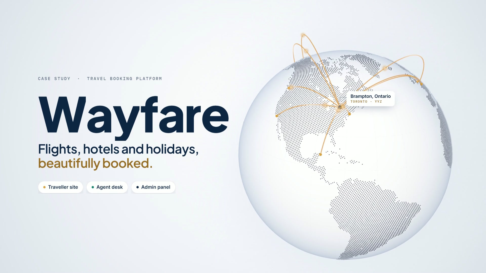
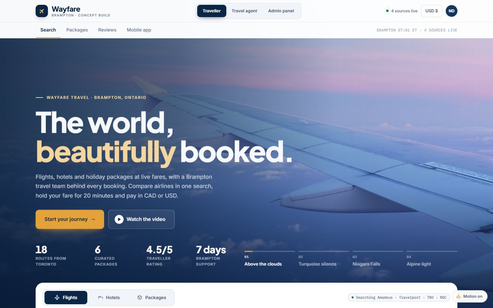
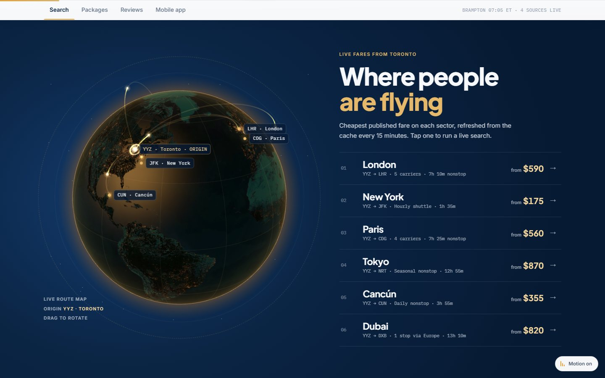
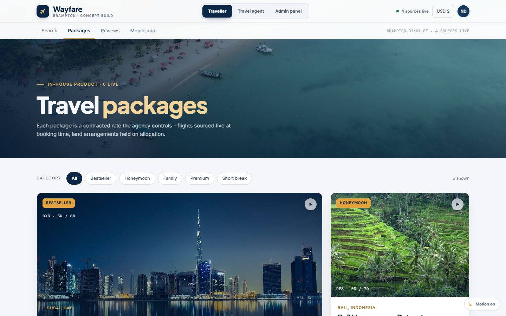
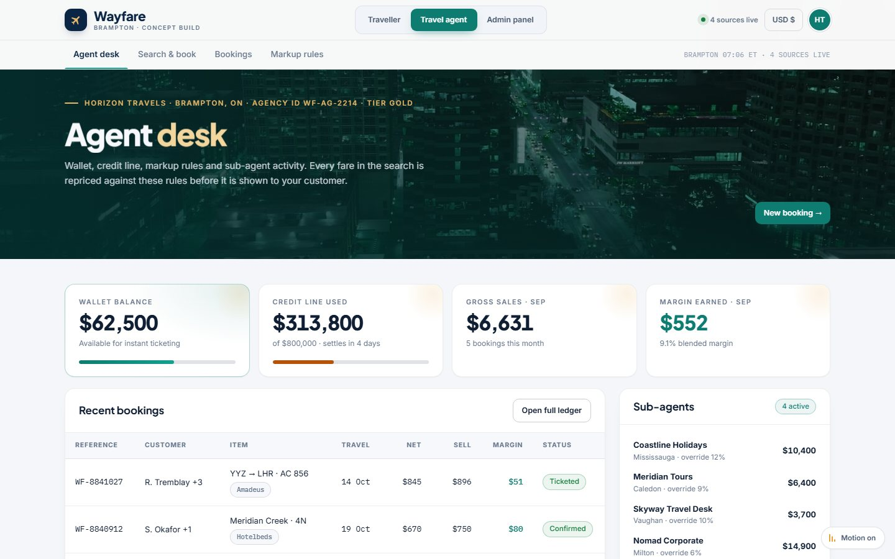
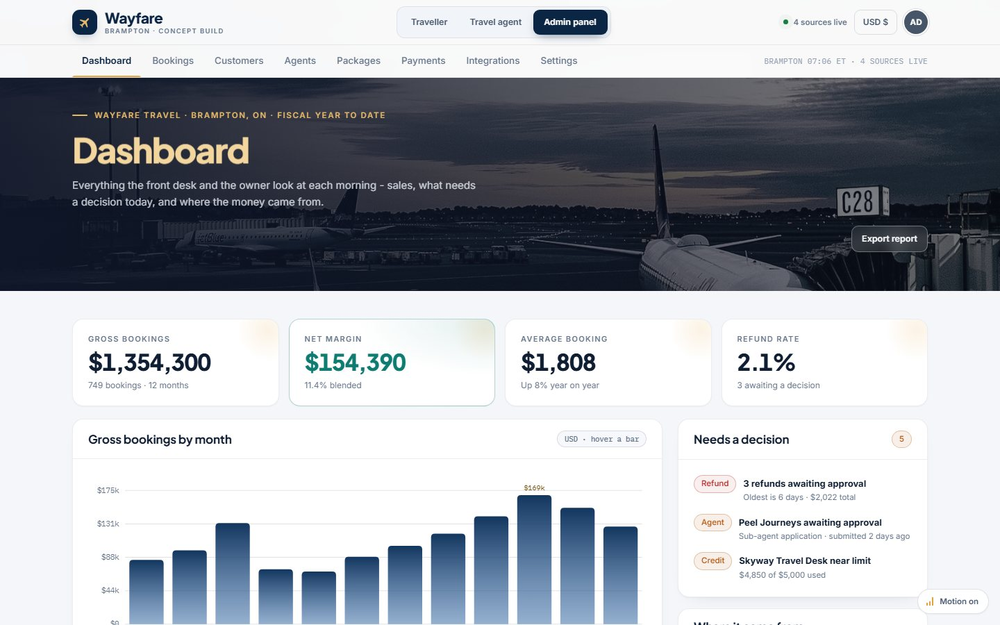

# Wayfare

Wayfare is a travel booking site built as a static front end. It has three parts that share one page: a traveller storefront, a travel-agent desk and an admin panel. The storefront uses video, a three.js route globe and GSAP scroll effects.

There is no backend. Flights, hotels, packages, prices, bookings, customers and reviews are sample data held in `js/app.js`, and the payment step uses a locked test card, so nothing is charged or sent. The agency is set in Brampton, Ontario, with Toronto (YYZ) as the home airport.



## Features

Storefront

- Video hero with four clips, crossfades and scene buttons with progress bars
- Full-screen video montage of 8 clips with chapter titles (Esc closes it, arrow keys skip)
- Search panel for flights, hotels and packages
- Route globe: a three.js Earth with animated flight arcs from the chosen origin. Hover a route to turn the globe to it, drag to spin, click a city label to search
- Pinned horizontal strip of destination cards with parallax
- Package grid with hover video, and an itinerary page for each package
- Flight and hotel results, checkout with a fare-hold countdown, and a boarding-pass confirmation
- Reviews carousel and a branch section

Agent desk

- Wallet, credit line, sales and margin tiles
- Search and book with agent pricing, a bookings ledger and markup rules

Admin panel

- Dashboard with a monthly bookings chart and items that need a decision
- Bookings, customers, agents, packages, payments, integrations and settings views

Site-wide

- Display currency switch (USD / CAD)
- Scroll progress line and a header that hides on scroll down
- A Motion on/off button (bottom right) that pauses every video and loop. If the OS has reduced motion turned on, only smooth scrolling is disabled, so use the button to stop everything

## Screenshots











## Run it

There is no build step. Serve the folder and open it in a browser:

```
node tools/serve.mjs
```

Then go to http://127.0.0.1:8620. Set `PORT` to use another port. This server supports HTTP Range requests, which Safari and iPhone need to play the videos.

`python -m http.server` also works on desktop browsers. Opening `index.html` directly works too, but the globe then loads its textures from a CDN, because browsers block local image files in WebGL.

An internet connection is needed for the fonts and for GSAP, ScrollTrigger, Lenis and three.js, which load from CDNs.

## Files

```
index.html          page shell (header, footer, video montage player)
css/style.css       design system and all layouts
js/app.js           booking engine: data, pricing, views, routing
js/cinema.js        motion layer: view fades, videos, scroll effects, montage
js/globe.js         three.js route globe
assets/video/       clips, poster frames and CREDITS.md
assets/img/         photos and CREDITS-A.md / CREDITS-B.md
assets/globe/       Earth textures
tools/serve.mjs     local static server with Range support
tools/build-credits.py   rebuilds the footer credits list from the CREDITS files
docs/screenshots/   images used in this README
```

## Design notes

- Light cool-grey page, white cards, navy text, gold for accents and the main buttons. Agent mode switches the accent to teal.
- The hero, page banners, globe band and footer are navy. The CSS remaps the same colour tokens to light-on-dark inside them.
- Plus Jakarta Sans for headings, Inter for text, IBM Plex Mono for codes (airports, PNRs, logs).

## Credits

- Videos: [Mixkit](https://mixkit.co/), Mixkit Stock Video Free License. Sources are listed in `assets/video/CREDITS.md`.
- Photos: Wikimedia Commons and Flickr, under CC0, CC BY or CC BY-SA. Authors and licences are listed in `assets/img/CREDITS-A.md` and `CREDITS-B.md`, and in the "Full photo & film credits" list in the site footer.
- Earth textures: the [three-globe](https://github.com/vasturiano/three-globe) project (MIT).
- Libraries: [three.js](https://threejs.org/), [GSAP](https://gsap.com/) with ScrollTrigger, [Lenis](https://github.com/darkroomengineering/lenis).
- Fonts: Plus Jakarta Sans, Inter and IBM Plex Mono from Google Fonts.

After editing a `CREDITS` file, rebuild the footer list with:

```
python tools/build-credits.py .
```
